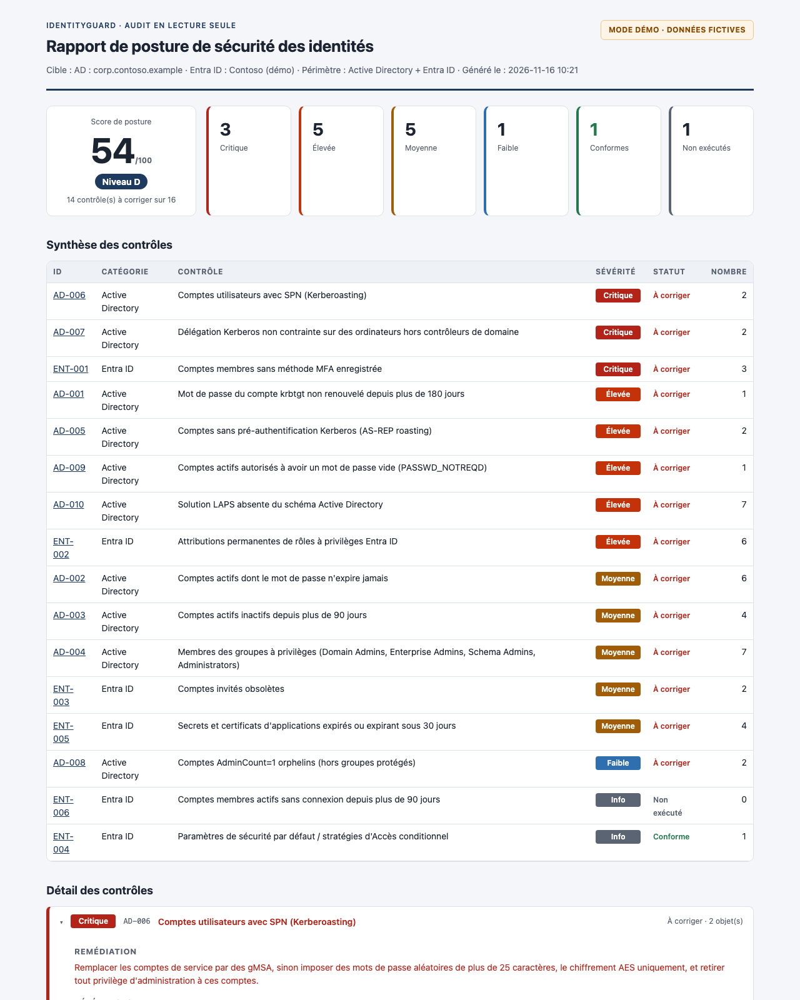

# IdentityGuard

> Audit **en lecture seule** de la posture de sécurité des identités Microsoft hybrides
> (Active Directory + Entra ID / Microsoft 365), avec un rapport HTML autonome en une seule commande.

```powershell
Invoke-IdentityGuard -Scope All -OutputPath .\rapport.html
```

IdentityGuard est un module PowerShell qui exécute 16 contrôles de sécurité ciblant les faiblesses
d'identité les plus exploitées lors d'intrusions (Kerberoasting, AS-REP roasting, délégation non
contrainte, comptes à privilèges permanents, absence de MFA…). Chaque constat indique sa sévérité,
le nombre d'objets concernés, la remédiation recommandée et les références ANSSI / Microsoft /
MITRE ATT&CK associées.



*Rapport généré avec `-DemoMode` (données entièrement fictives) : [docs/demo-report.html](docs/demo-report.html).*

---

## Sommaire

- [Principes](#principes)
- [Contrôles réalisés](#contrôles-réalisés)
- [Prérequis](#prérequis)
- [Permissions (lecture seule)](#permissions-lecture-seule)
- [Utilisation](#utilisation)
- [Format des résultats](#format-des-résultats)
- [Architecture](#architecture)
- [Tests](#tests)
- [Limites connues](#limites-connues)
- [Licence](#licence)

## Principes

- **Lecture seule** : seules des cmdlets `Get-*` (module ActiveDirectory et SDK Microsoft Graph)
  sont utilisées. Aucune modification n'est faite dans l'annuaire ou le tenant.
- **Résilient** : chaque contrôle est isolé. Un module manquant, une permission absente ou une
  licence insuffisante produit un constat `Info – Contrôle non exécuté : <raison>` au lieu
  d'interrompre l'audit.
- **Rapport autonome** : un seul fichier HTML (CSS intégré, aucun script ni ressource externe),
  consultable hors ligne et archivable. Toutes les valeurs issues de l'annuaire sont encodées en
  HTML pour empêcher toute injection via un nom d'objet malveillant.
- **Mode démo** : `-DemoMode` génère un rapport complet à partir de données synthétiques
  (`contoso.example`), sans aucun accès à un domaine ou un tenant.

## Contrôles réalisés

### Active Directory

| Id | Contrôle | Sévérité si non conforme | Références |
|----|----------|--------------------------|------------|
| AD-001 | Mot de passe `krbtgt` (et `krbtgt_*` des RODC) non changé depuis plus de 180 jours | Élevée | MITRE T1558.001 (Golden Ticket), ANSSI |
| AD-002 | Comptes actifs avec `PasswordNeverExpires` | Moyenne | MITRE T1078.002, T1110, ANSSI |
| AD-003 | Comptes actifs inactifs depuis plus de 90 jours (`lastLogonTimestamp`) | Moyenne | MITRE T1078.002, ANSSI |
| AD-004 | Membres (récursifs) de Domain Admins, Enterprise Admins, Schema Admins, Administrators | Faible → Élevée selon le nombre | MITRE T1078.002, T1069.002, ANSSI |
| AD-005 | Comptes sans pré-authentification Kerberos (AS-REP roasting) | Élevée (Critique si compte à privilèges) | MITRE T1558.004, ANSSI |
| AD-006 | Comptes utilisateurs avec SPN (Kerberoasting) | Élevée (Critique si compte à privilèges) | MITRE T1558.003, ANSSI |
| AD-007 | Délégation Kerberos non contrainte sur des ordinateurs hors DC | Critique | MITRE T1558, T1187, ANSSI |
| AD-008 | Comptes `adminCount=1` orphelins (hors groupes protégés) | Faible | MITRE T1078.002, AdminSDHolder |
| AD-009 | Comptes actifs avec `PASSWD_NOTREQD` | Élevée (Critique si compte à privilèges) | MITRE T1078.002, T1110.001, ANSSI |
| AD-010 | LAPS absent du schéma (`ms-Mcs-AdmPwd` / `msLAPS-Password`) | Élevée | MITRE T1078.003, T1550.002, ANSSI |

### Entra ID

| Id | Contrôle | Sévérité si non conforme | Références |
|----|----------|--------------------------|------------|
| ENT-001 | Comptes membres sans méthode MFA enregistrée | Élevée (Critique si administrateur) | MITRE T1078.004, T1110.003 |
| ENT-002 | Attributions **permanentes** de rôles à privilèges (Global Administrator, Privileged Role Administrator, Security Administrator…) | Moyenne (Élevée si plus de 4 Global Admins) | MITRE T1078.004, T1098.003 |
| ENT-003 | Invités obsolètes (sans connexion depuis 90 jours, ou invitation en attente depuis plus de 30 jours) | Moyenne | MITRE T1078.004 |
| ENT-004 | Ni paramètres de sécurité par défaut, ni stratégie d'Accès conditionnel activée | Critique | MITRE T1078.004, T1110 |
| ENT-005 | Secrets / certificats d'applications expirés ou expirant sous 30 jours | Moyenne | MITRE T1098.001 |
| ENT-006 | Comptes membres actifs sans connexion depuis plus de 90 jours (`signInActivity`, Entra ID P1) | Moyenne | MITRE T1078.004 |

Référence ANSSI : [Points de contrôle Active Directory (CERT-FR)](https://www.cert.ssi.gouv.fr/uploads/guide-ad.html).
Les liens Microsoft Learn détaillés figurent dans chaque constat du rapport.

Un constat conforme est affiché avec la sévérité `Info` et le statut `Conforme`.

## Prérequis

| Élément | Détail |
|---------|--------|
| PowerShell | Windows PowerShell 5.1 ou PowerShell 7.2+ |
| Contrôles AD | Module `ActiveDirectory` (RSAT), poste membre du domaine, compte utilisateur du domaine (aucun droit d'administration requis pour les attributs lus) |
| Contrôles Entra | SDK `Microsoft.Graph` : `Microsoft.Graph.Authentication`, `.Users`, `.Reports`, `.Identity.SignIns`, `.Identity.Governance`, `.Identity.DirectoryManagement`, `.Applications` |
| Licences | ENT-006 et le critère « dernière connexion » d'ENT-003 nécessitent **Entra ID P1** ; la détection PIM d'ENT-002 utilise **Entra ID P2** si disponible (repli automatique sinon) |
| Mode démo | Aucun module externe requis |

```powershell
# RSAT (Windows 10/11)
Add-WindowsCapability -Online -Name Rsat.ActiveDirectory.DS-LDS.Tools~~~~0.0.1.0

# Microsoft Graph SDK
Install-Module Microsoft.Graph -Scope CurrentUser
```

## Permissions (lecture seule)

Scopes Microsoft Graph délégués utilisés (tous en lecture) :

| Scope | Utilisé par |
|-------|-------------|
| `User.Read.All` | ENT-002, ENT-003, ENT-006 (liste des utilisateurs) |
| `AuditLog.Read.All` | ENT-003, ENT-006 (`signInActivity`), ENT-001 (rapport d'enregistrement) |
| `Directory.Read.All` | Nom du tenant, résolution des principaux |
| `Policy.Read.All` | ENT-004 (paramètres de sécurité par défaut, Accès conditionnel) |
| `UserAuthenticationMethod.Read.All` | ENT-001 (méthodes d'authentification) |
| `RoleManagement.Read.Directory` | ENT-002 (attributions de rôles / PIM) |
| `Application.Read.All` | ENT-005 (inscriptions d'applications) |

Rôle Entra minimal recommandé pour l'auditeur : **Global Reader** (+ **Reports Reader** pour les rapports
d'authentification). Côté AD, un compte utilisateur standard suffit.

## Utilisation

```powershell
Import-Module .\IdentityGuard\IdentityGuard.psd1

# 1. Démonstration sans environnement (données fictives)
Invoke-IdentityGuard -DemoMode -OutputPath .\docs\demo-report.html

# 2. Active Directory uniquement, depuis un poste du domaine
Invoke-IdentityGuard -Scope AD -OutputPath C:\Audit\

# 3. Entra ID uniquement
Connect-MgGraph -Scopes 'User.Read.All', 'AuditLog.Read.All', 'Directory.Read.All', 'Policy.Read.All',
                        'UserAuthenticationMethod.Read.All', 'RoleManagement.Read.Directory', 'Application.Read.All'
Invoke-IdentityGuard -Scope Entra

# 4. Audit complet et exploitation des résultats dans le pipeline
$audit = Invoke-IdentityGuard -Scope All -OutputPath .\rapport.html
$audit.Findings | Where-Object Status -eq 'À corriger' | Sort-Object Severity | Format-Table Id, Severity, Count, Title
$audit.Findings | ConvertTo-Json -Depth 5 | Set-Content .\rapport.json
```

| Paramètre | Valeurs | Défaut |
|-----------|---------|--------|
| `-Scope` | `AD`, `Entra`, `All` | `All` |
| `-OutputPath` | Fichier `.html` ou dossier existant | `IdentityGuard-Report-<horodatage>.html` dans le dossier courant |
| `-DemoMode` | Switch | désactivé |

## Format des résultats

`Invoke-IdentityGuard` écrit le rapport HTML et retourne un objet `ReportPath`, `Score`, `Grade`,
`Failed`, `Passed`, `NotRun` et `Findings`. Chaque constat a une structure uniforme :

| Propriété | Description |
|-----------|-------------|
| `Id` | Identifiant stable (`AD-001`, `ENT-004`…) |
| `Category` | `Active Directory` ou `Entra ID` |
| `Title` | Intitulé du contrôle |
| `Severity` | `Critique`, `Élevée`, `Moyenne`, `Faible`, `Info` |
| `Status` | `À corriger`, `Conforme`, `Non exécuté` |
| `Count` | Nombre d'objets concernés |
| `Items` | Objets concernés (`Name`, `Detail`) |
| `Note` | Contexte (seuil appliqué, raison de non-exécution…) |
| `Remediation` | Action corrective recommandée |
| `Reference` | ANSSI / Microsoft / MITRE ATT&CK |

**Score de posture** : chaque constat à corriger retire un poids selon sa sévérité
(Critique 20, Élevée 10, Moyenne 5, Faible 2), rapporté au pire cas (tous les contrôles exécutés en
échec critique). Les contrôles non exécutés sont exclus du calcul et signalés séparément.
Niveaux : A ≥ 90, B ≥ 75, C ≥ 60, D ≥ 40, E < 40.

## Architecture

```
IdentityGuard/
├── IdentityGuard/                  # Module PowerShell
│   ├── IdentityGuard.psd1 / .psm1
│   ├── Public/Invoke-IdentityGuard.ps1
│   ├── Private/
│   │   ├── Core/                   # Catalogue des contrôles, constats, isolation des erreurs, dates
│   │   ├── Sources/                # Collecte AD / Graph (Get-* uniquement) + fournisseur démo, avec cache
│   │   ├── Checks/AD/              # Un fichier par contrôle AD-0xx
│   │   ├── Checks/Entra/           # Un fichier par contrôle ENT-0xx
│   │   └── Report/                 # Génération HTML, encodage, score
│   └── Data/demo-fixtures.json     # Données synthétiques du mode démo
├── tests/                          # Tests Pester 5 (cmdlets AD/Graph simulées)
├── scripts/Invoke-Validation.ps1   # Tests + rapport démo + capture d'écran
├── docs/                           # Rapport de démonstration
└── .github/workflows/ci.yml        # Pester (Linux, Windows, PowerShell 5.1) + PSScriptAnalyzer
```

Les contrôles ne dialoguent jamais directement avec AD ou Graph : ils demandent une **source**
nommée (`ADUsers`, `EntraRegistration`…) collectée une seule fois par exécution puis mise en cache,
y compris en cas d'erreur. Le mode démo remplace simplement le fournisseur de sources, ce qui
garantit que la logique testée est celle exécutée en production.

## Tests

```powershell
Install-Module Pester -MinimumVersion 5.5.0 -Scope CurrentUser -Force -SkipPublisherCheck
Invoke-Pester -Path .\tests -Output Detailed

# ou, en une commande : tests + docs/demo-report.html + docs/demo-report.png (si Chrome est installé)
pwsh .\scripts\Invoke-Validation.ps1 -InstallPester
```

Les tests couvrent la logique de chaque contrôle (cas conformes / non conformes / escalade de
sévérité), la non-exécution gracieuse (module absent, accès refusé, licence P1 manquante), le cache
des sources, l'encodage HTML face à des noms d'objets hostiles et la génération complète en mode démo.

## Limites connues

- **LAPS (AD-010)** : seule la présence des attributs dans le schéma est vérifiée, pas la couverture
  effective de chaque poste par une stratégie LAPS.
- **Inactivité AD (AD-003)** : `lastLogonTimestamp` est répliqué avec un décalage pouvant atteindre
  14 jours ; seuls les comptes utilisateurs sont évalués (pas les comptes ordinateurs).
- **Groupes à privilèges (AD-004)** : le domaine courant et le domaine racine de la forêt sont
  interrogés ; les autres domaines de la forêt et les relations d'approbation ne sont pas couverts.
  Les comptes orphelins (AD-008) sont rapprochés par `sAMAccountName`.
- **Entra ID P1 / P2** : sans P1, ENT-006 est signalé « non exécuté » et ENT-003 se replie sur les
  invitations en attente ; sans P2 (PIM), toutes les attributions actives de rôles sont considérées
  permanentes.
- **Rôles personnalisés** : ENT-002 ne considère que les rôles intégrés listés dans
  `Private/Core/Constants.ps1`.
- **Volumétrie** : les objets utilisateurs et ordinateurs sont lus en une passe ; sur de très grands
  annuaires (> 100 000 objets), prévoir du temps et de la mémoire. Le rapport HTML affiche au plus
  200 objets par constat (la liste complète reste disponible dans l'objet retourné).
- IdentityGuard est un outil d'aide à l'audit : il ne remplace ni un test d'intrusion ni des outils
  spécialisés comme PingCastle, Purple Knight ou ORADAD (ANSSI).

## Licence

Distribué sous licence [MIT](LICENSE) — © 2026 Papa Mamadou Gueye.
